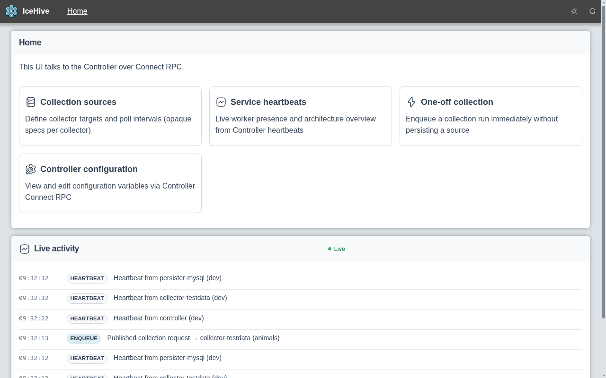
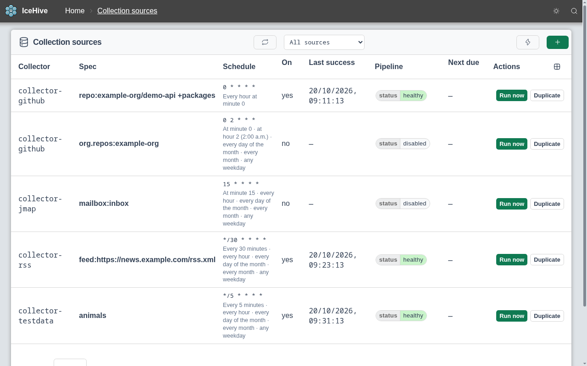
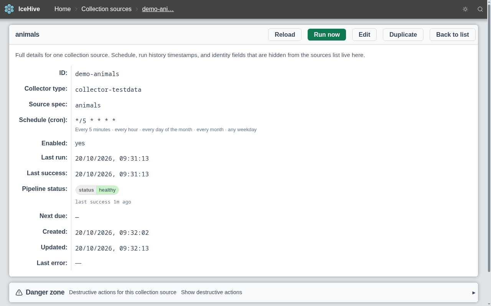
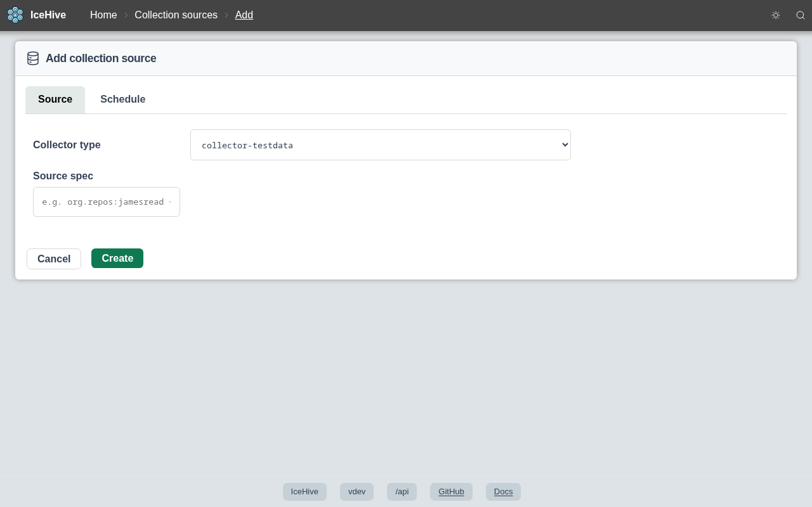
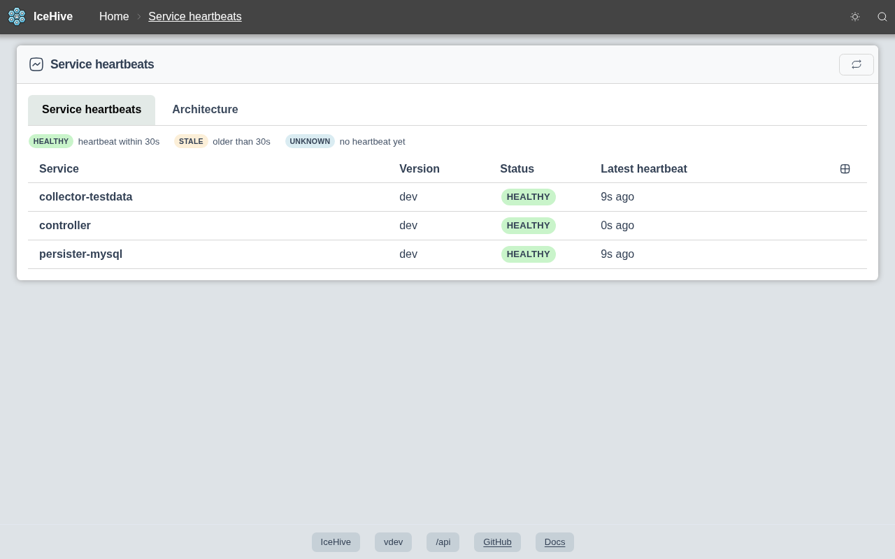
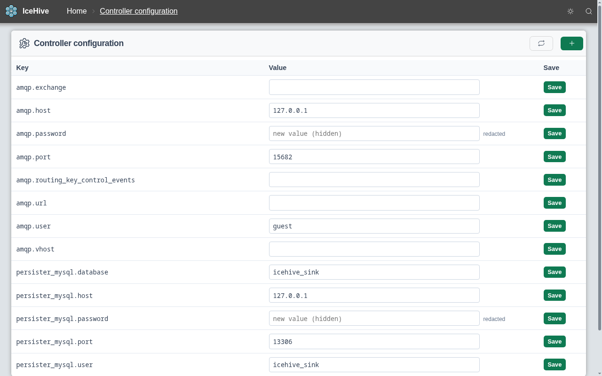
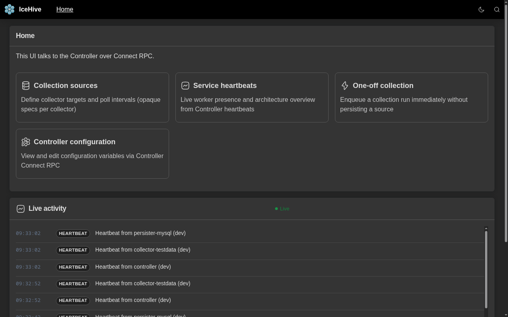

<div align="center">
  
  <h1>IceHive</h1>

  IceHive is a set of microservices that **collect** data from various APIs, **normalize** it into a standard format, and **store** it in a database.

[](#none)
[](https://goreportcard.com/report/github.com/icehive/icehive)

</div>

## What it does

- **Controller** exposes a gRPC API (Connect) for clients to query and request data.
- **Collector binaries** (for example `collector-github`, `collector-azure`, `collector-testdata`) run on a schedule, pull data from a specific vendor API (or emit deterministic test fixtures), normalize it, and publish to RabbitMQ. Shared collector runtime code lives in **common** (`pkg/collector`).
- **Persister binaries** (for example `persister-yaml`, `persister-mysql`) consume normalized messages from the queue and write them using a sink-specific implementation of `persist.Store` in **common** (`pkg/persist`).
- **Common** holds shared library code used by all services (configuration loading, AMQP control helpers, HTTP auth shim wrapper, etc.).

The **frontend** is a web application that talks to the Controller for viewing and requesting data.

## Screenshots

### Home and live activity



The home page links to every area of IceHive and streams a live feed of what the system is doing: heartbeats from each service, collection requests being sent, and runs. You can see at a glance that data is flowing without opening logs or a message broker console.

### Collection sources



Every source you collect from (GitHub repos and orgs, RSS feeds, mailboxes, …) in one table, with its schedule written out in plain English, when it last succeeded, and a health badge. You can spot a broken or overdue source quickly and use **Run now** without waiting for the next scheduled run.

### Source details



Everything about a single source on one page: spec, schedule, last run, last success, pipeline status and last error. This is the place to start when you need to answer "why hasn't this data updated?"

### Adding a source



New sources are added from a form: pick a collector type, write a source spec, and set a schedule. Adding something new to collect doesn't need a config change or a redeploy.

### Service heartbeats



Shows which collectors, persisters and controllers are running, the version each one reports, and how long ago it last checked in. It confirms that a deployment or upgrade actually came up, and makes a stopped worker easy to spot.

### Controller configuration



Shared settings such as the message broker and database connections are edited in the UI and handed out to the workers. Passwords and tokens are always redacted, so this screen is safe to share or screen-record.

### Dark mode



A built-in dark theme for operators who live in dark terminals and dashboards.

Screenshots use fictional test data and are regenerated with `make screenshots` (see [`var/marketing/screenshots`](var/marketing/screenshots/README.md)).

## Getting started

IceHive ships as a single container image, **`ghcr.io/jamesread/icehive`**, that holds every service. Set `ICEHIVE_SERVICE` (`controller`, `frontend`, `collector-github`, `persister-mysql`, …) to choose which one a container runs:

```bash
docker run -e ICEHIVE_SERVICE=controller ghcr.io/jamesread/icehive:latest
```

**Deploying on Kubernetes is the recommended approach.** Run the controller, collectors and persisters as separate Deployments from the same image, alongside MySQL and RabbitMQ. See [Deploying IceHive → Kubernetes](docs/content/deployment.md#typical-kubernetes-footprint) and the ready-to-edit [example manifest](docs/content/examples/kubernetes-icehive.yaml).

### Building from source

To develop IceHive you need Go, Node.js, Make, and [Buf](https://buf.build/docs/installation/) for protocol buffers. Clone the repository, generate code, build, and run the component you care about:

```bash
make
```

See `Makefile` targets for build, test, lint, and running individual services. Developer-oriented documentation lives under `docs/` (MkDocs).
